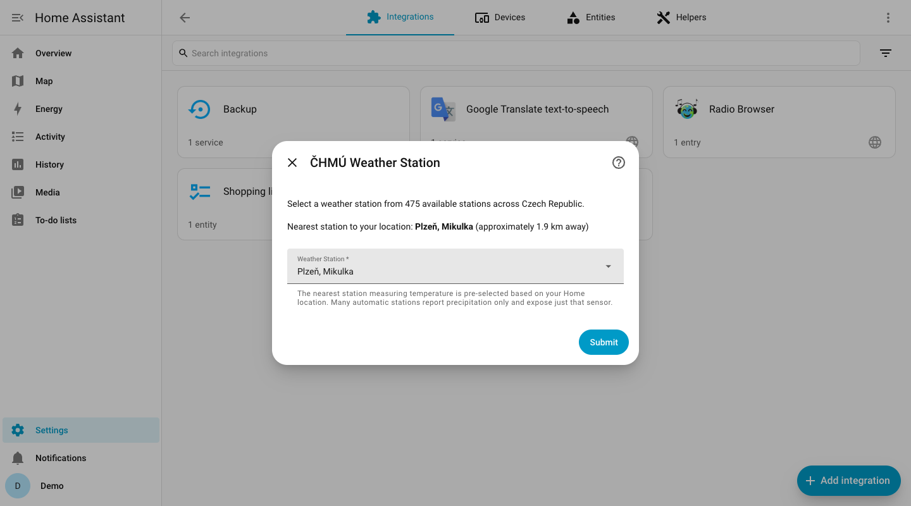

# ČHMÚ Weather Home Assistant Integration

🇨🇿 **Integrace pro Home Assistant poskytující data z meteorologických stanic Českého hydrometeorologického ústavu (ČHMÚ). Primárně určeno pro české uživatele z důvodu geografické dostupnosti stanic.**

🇬🇧 **Home Assistant integration providing weather data from Czech Hydrometeorological Institute (ČHMÚ) meteorological stations. Primarily intended for Czech audience due to the geographic proximity of weather stations.**


---

A Home Assistant integration to fetch weather data from ČHMÚ (Czech Hydrometeorological Institute).

[](https://github.com/hacs/integration)
[](https://github.com/lipelix/home-assistant-chmu-weather/releases)
[](https://github.com/lipelix/home-assistant-chmu-weather/actions/workflows/ci.yml)

## Installation

### HACS (Recommended)

1. Open HACS in your Home Assistant instance
2. Click on "Integrations"
3. Click the three dots in the top right corner
4. Select "Custom repositories"
5. Add this repository URL: `https://github.com/lipelix/home-assistant-chmu-weather`
6. Select category: `Integration`
7. Click "Add"
8. Find "ČHMÚ Weather" in the integration list and click "Download"
9. Restart Home Assistant
10. Go to Settings → Devices & Services → Add Integration
11. Search for "ČHMÚ Weather" and follow the configuration steps

### Manual Installation

1. Copy the `custom_components/chmu` directory to your Home Assistant `config/custom_components/` directory
2. Restart Home Assistant
3. Go to Settings → Devices & Services → Add Integration
4. Search for "ČHMÚ Weather" and follow the configuration steps

## Configuration

The integration is configured via the UI (Config Flow). No YAML configuration is needed.
The station nearest to your Home location is pre-selected.



## Features

- Data from all ~475 ČHMÚ stations publishing 10-minute measurements; the
  nearest one is pre-selected
- Sensors for temperature, humidity, pressure, precipitation, wind speed and
  direction (only those the station measures), plus the national text forecast
- A weather entity with a **per-station forecast** from the ČHMÚ ALADIN 1 km
  model - see [How far ahead](#how-far-ahead)
- Every 10-minute measurement kept as **hourly statistics**

### Hourly statistics

ČHMÚ publishes an hour's six 10-minute readings at once, so only the newest can
become the sensor state. The rest are kept as hourly statistics (mean, min, max)
named `chmu:{station}_{element}`, e.g. `chmu:11450_temperature`, ready for a
Statistics graph card. Precipitation is not included.

### Where the forecast comes from

ČHMÚ's raw model output is ~70 MB per run, too much for Home Assistant to
download. A [job in this repository](.github/workflows/forecast-data.yml)
samples each new ALADIN CZ_1km run at ~750 station coordinates and publishes
~1.5 kB per station on GitHub Pages; your Home Assistant fetches only its own
station's file. No account, token or analytics. A forecast older than 18 hours
logs a warning, a model run older than 48 hours is refused. Details in
[`ARCHITECTURE.md`](custom_components/chmu/ARCHITECTURE.md).

### How far ahead

| Forecast | Available | Why |
|---|---|---|
| Current conditions | every 10 minutes | Measured at the station, not modelled. |
| Hourly | 62–70 hours | ALADIN runs every 6 hours and reaches 72 hours ahead, but each run is published 3–4½ hours after it starts. |
| Daily | 3 days (4 in the evening) | A day is shown only when the model covers its afternoon high. Once the model run no longer covers last night, today's low is the minimum the station measured. |
| Beyond 3 days | not offered | ČHMÚ's longer forecast is national only and ignores altitude (~10 °C between Sněžka and Plzeň). No data beats a guess. |


## Development

### Running Tests

To run the tests locally:

```bash
# Install development dependencies
pip install -r requirements-dev.txt

# Run tests
pytest tests/ -v
```

The test suite includes unit tests for API helpers and data parsing. Tests are automatically run via pre-commit hooks before each commit to ensure code quality.

### Code Quality

Before committing, ensure your code passes linting:

```bash
./lint.sh  # Runs ruff + HACS validation
```

Pre-commit hooks will automatically run ruff and pytest on commit. To set up pre-commit hooks:

```bash
pip install pre-commit
pre-commit install
```

## Support

If you have issues or questions, please:
- Check the [documentation](https://github.com/lipelix/home-assistant-chmu-weather)
- Open an [issue](https://github.com/lipelix/home-assistant-chmu-weather/issues)

## License

This project is licensed under the MIT License - see the [LICENSE](LICENSE) file for details.
