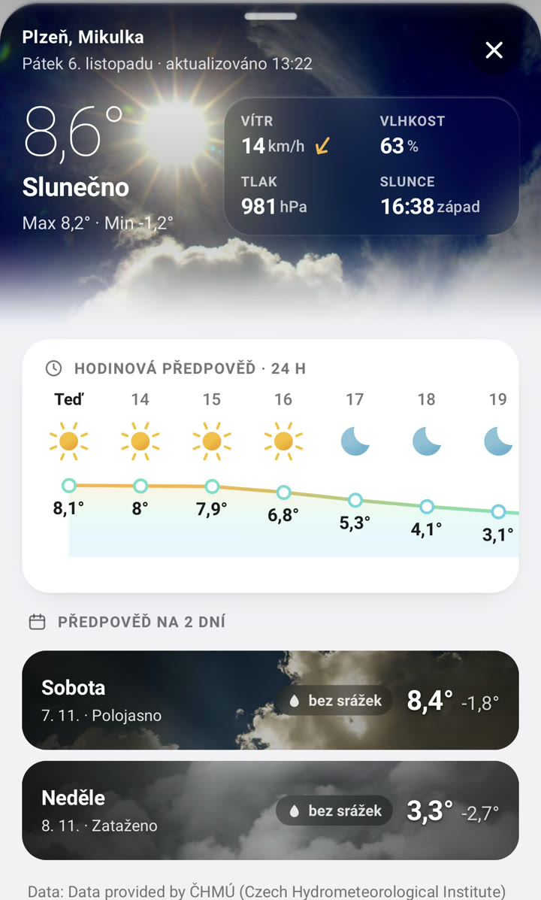
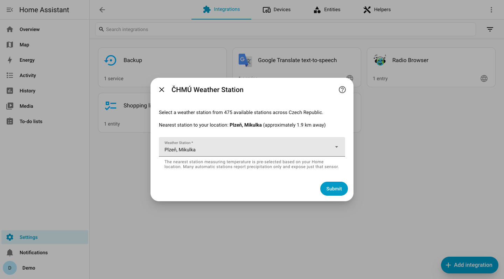
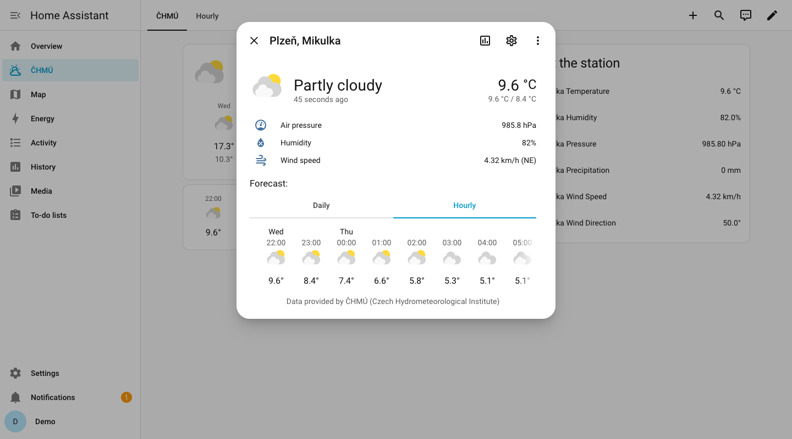

# ČHMÚ Weather for Home Assistant

**Real measurements from the official Czech weather station nearest you, and a 1 km forecast for that exact spot.** Every 10 minutes, no account, no API key.

**Česky:** Skutečně naměřená data z nejbližší stanice ČHMÚ a předpověď modelu ALADIN 1 km přímo pro místo stanice. Každých 10 minut, bez registrace a bez API klíče.

 
<em>The weather entity in <a href="https://github.com/eMalinos/weather-bar-card">Weather Bar Card</a>.</em>

## What you get

One device per station:

- **Weather**: current conditions, hourly forecast for 62–70 hours, daily for 3 days
- **Temperature**
- **Humidity**
- **Pressure**
- **Precipitation**
- **Wind speed** and **wind direction**
- **Weather description**: the national ČHMÚ text forecast

Sensors are created only for what the station measures. Each 10-minute measurement is also kept as hourly statistics.

## Why this one

- **Measured, not modelled.** Temperature, humidity, pressure, rain and wind come from one of ~475 ČHMÚ stations, refreshed every 10 minutes. The station nearest your Home location is picked for you.
- **A forecast for your station, not for the country.** ČHMÚ's ALADIN model at 1 km resolution, sampled at your station's coordinates: 62–70 hours hourly and 3 days daily. Altitude counts: a hilltop station and the town below it get their own numbers.
- **Every measurement kept.** All six 10-minute readings of each hour are stored as hourly statistics (mean, min, max), so graphs show the whole day, not one point per hour.
- **Nothing to configure.** Set up from the UI in one step. No account, token, YAML or analytics.

## Make it look great: Weather Bar Card

The weather entity works with any weather card, including the built-in ones. It pairs best with [**Weather Bar Card**](https://github.com/eMalinos/weather-bar-card): a full-width bar with a photo of the current weather, and a detail with an hourly curve, current conditions and the daily forecast. Because this integration provides an hourly forecast, the card's hourly curve can reach almost three days ahead.

## Installation

### Marketplace / HACS (recommended)

ČHMÚ Weather is in the HACS default store, which Home Assistant now shows as its Marketplace. No custom repository needed.

1. Click **Open Marketplace repository** above, or search for **ČHMÚ Weather** in the Marketplace (HACS).
2. Click **Download**, then restart Home Assistant.
3. Click **Add integration** above, or go to **Settings → Devices & services → Add integration** and search for **ČHMÚ Weather**.
4. Confirm the pre-selected nearest station, or pick another one.

### Manual

1. Copy `custom_components/chmu` into your Home Assistant `config/custom_components/` directory.
2. Restart Home Assistant and add **ČHMÚ Weather** under **Settings → Devices & services**.

## How far ahead

| Forecast | Available | Why |
|---|---|---|
| Current conditions | every 10 minutes | Measured at the station, not modelled. |
| Hourly | 62–70 hours | ALADIN runs every 6 hours and reaches 72 hours ahead, but each run is published 3–4½ hours after it starts. |
| Daily | 3 days (4 in the evening) | A day is shown only when the model covers its afternoon high. Once the model run no longer covers last night, today's low is the minimum the station measured. |
| Beyond 3 days | not offered | ČHMÚ's longer forecast is national only and ignores altitude (~10 °C between Sněžka and Plzeň). No data beats a guess. |

## Where the forecast comes from

ČHMÚ's raw model output is ~70 MB per run, too much for Home Assistant to download. A [job in this repository](https://github.com/lipelix/home-assistant-chmu-weather/blob/main/.github/workflows/forecast-data.yml) samples each new ALADIN CZ_1km run at ~750 station coordinates and publishes ~1.5 kB per station on GitHub Pages; your Home Assistant fetches only its own station's file. A forecast older than 18 hours logs a warning, a model run older than 48 hours is refused. Details in [`ARCHITECTURE.md`](https://github.com/lipelix/home-assistant-chmu-weather/blob/main/custom_components/chmu/ARCHITECTURE.md).

## Hourly statistics

Each 10-minute measurement is stored as hourly statistics (mean, min, max) named `chmu:{station}_{element}`, e.g. `chmu:11450_temperature`, ready for a Statistics graph card. Precipitation is not included.

## Support

Found a bug or missing a station? Open an [issue](https://github.com/lipelix/home-assistant-chmu-weather/issues). If the integration is useful to you, a star on GitHub helps other people find it.

Contributing: see [`DEVELOPMENT.md`](https://github.com/lipelix/home-assistant-chmu-weather/blob/main/DEVELOPMENT.md) for tests, linting and pre-commit hooks.

## License

MIT, see [LICENSE](https://github.com/lipelix/home-assistant-chmu-weather/blob/main/LICENSE). Weather data: [ČHMÚ open data](https://opendata.chmi.cz).
